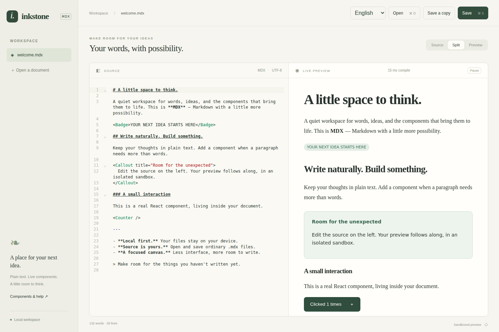
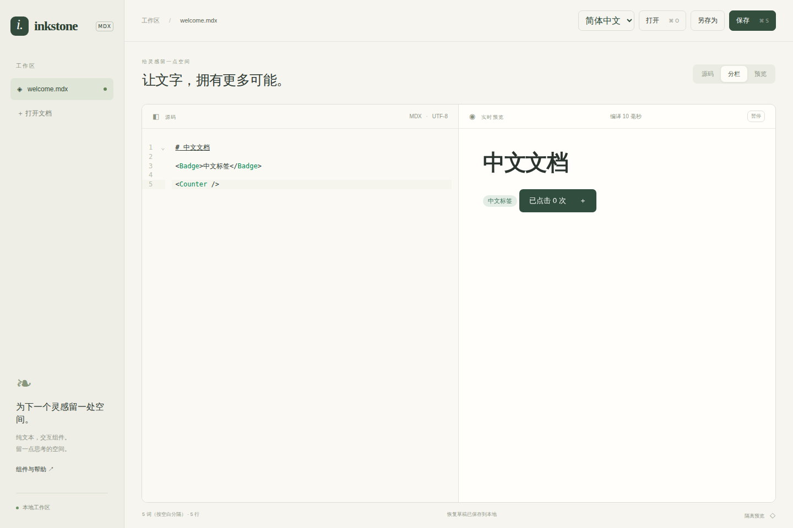
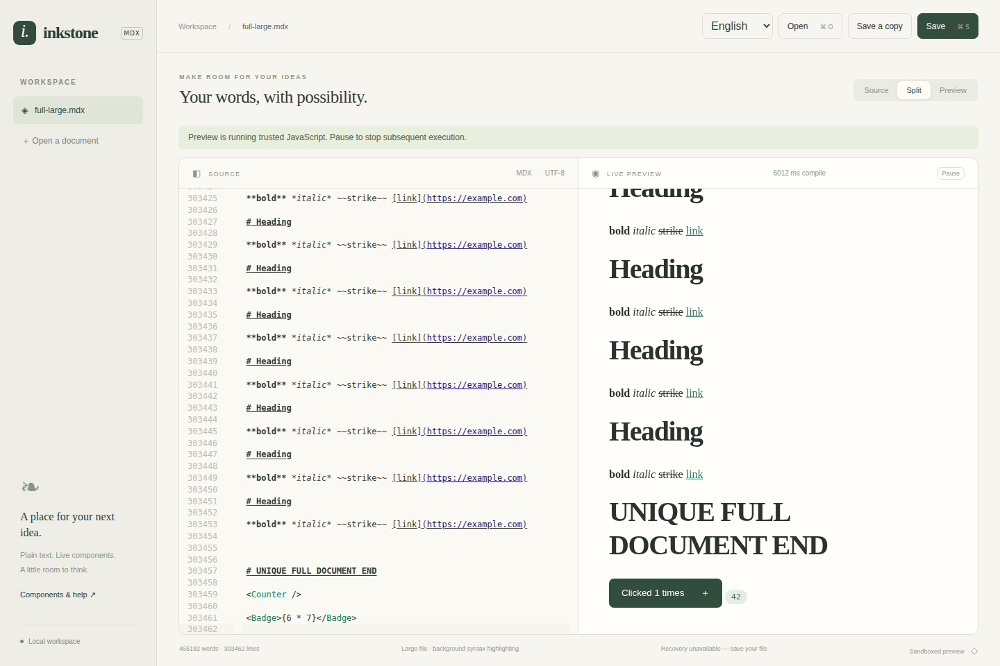

# Inkstone MDX

**Your words, with possibility.**

A local-first, source-first MDX editor. Write Markdown and React components in a quiet split workspace, then interact with the rendered result. Available as a web app and an Electron desktop app for Windows, macOS and Linux.

[简体中文](README.md) · [MIT License](LICENSE) · [Desktop guide](docs/DESKTOP.md) · [Validation](docs/EXTENDED-VALIDATION.md)

> **Development preview:** full large-file preview has been merged into main via [PR #4](https://github.com/kingshuoxu/inkstone-mdx/pull/4), but has not been formally released. Desktop packages are unsigned and macOS builds are not notarized. Only run trusted documents and projects.

## Live preview

The normal working view below has preview enabled: source on the left, the rendered document and interactive React components on the right.



## What it does

- **Markdown meets React:** GFM tables, task lists and strikethrough; JSX and JavaScript expressions; interactive `Callout`, `Badge`, `Card` and `Counter` components.
- **Focused editing:** Source, Split and Preview layouts, line numbers, search, undo/redo, bracket completion and Markdown-oriented syntax highlighting. Not a complete MDX language service.
- **Chinese and English UI:** switch languages and remember the choice locally without translating the document. UTF-8 Chinese filenames and content are supported.
- **Local files:** open `.mdx`, `.md` and `.markdown`; save, save a copy, detect unsaved edits and check for external modifications. Desktop uses native file operations; web direct writes depend on browser support, otherwise a copy is downloaded.
- **Trusted desktop projects:** preview local components and installed browser-compatible npm dependencies. Revoke trust at any time. No automatic dependency installation or execution of project build configuration.
- **Rust/WASM compilation core:** parsing, AST transforms and JavaScript generation for larger documents, with JS fallback for small inputs and compatibility cases. The UI, file layer and React renderer remain JavaScript.
- **Large files keep their colors:** above one million UTF-16 units, a background worker incrementally parses the document and returns only visible-range styling. Input does not wait for full-document highlighting.
- **Local-first:** no account, backend, paid service, app telemetry or document upload. Recovery drafts stay in the local browser/app profile and are not a durable backup.

### Chinese interface with preview enabled



### Complete large-file preview

A real test fixture of roughly 5 MiB and 303,462 lines keeps source highlighting and a complete preview. Both panes are scrolled to the document end; the final Counter has been clicked successfully.



All screenshots above show production build `cea179e` running in Chromium, not mockups. Documents are synthetic fixtures. See [screenshot provenance and checksums](docs/screenshots/README.md).

## Measured performance

Complete-preview observations for `cea179e` on a GitHub Actions Linux runner, Chromium, production build. **These include compilation and React readiness, not just parsing.** Each fixture is a single test observation, not a repeated-run median.

| Document                          | UTF-8 bytes |   Lines | Compile start to React ready | After enabling preview to observed ready | DOM elements |
| --------------------------------- | ----------: | ------: | ---------------------------: | ---------------------------------------: | -----------: |
| Long plain paragraphs             |   5,231,639 |   2,762 |                      1.504 s |                                  3.384 s |        1,391 |
| Rich headings, emphasis and links |   5,234,634 | 303,462 |                     13.741 s |                                 15.768 s |      455,193 |

[Corresponding Verify CI](https://github.com/kingshuoxu/inkstone-mdx/actions/runs/44262522045). Both cases verify the unique final heading, the final Counter interaction and a new heading after editing. The Rust parser's indexed edit map reduces repeated linear scans in long documents; worker highlighting avoids making input wait for full-document highlighting.

Document structure matters: similar source sizes do not imply similar preview times. Large React trees still take time and memory. These observations are not device-independent latency or frame-rate guarantees. See [full-preview boundaries](docs/LARGE-PREVIEW.md) and the [historical Rust compiler benchmark](docs/RUST-PERFORMANCE.md).

### Current boundaries

- Colors can arrive briefly after opening, scrolling or editing. The large-file worker path does not provide syntax-driven folding or indentation.
- Opening files is capped at **5 MiB**, as are desktop save/IPC operations. Complete preview source is also capped at **5 MiB**. See [limits](docs/LIMITS.md).
- Recovery depends on local storage quota; save valuable work to disk.
- Web mode rejects project imports. Desktop does not support Node native addons, server-only dependencies or arbitrary project plugins. See [supported project boundaries](docs/DESKTOP.md#supported-boundaries).
- `.md` files are also parsed as MDX, not a plain-Markdown compatibility mode. Literal braces or angle brackets may need escaping.

## Get started

### Desktop test packages

Download platform artifacts from [the verified cea179e snapshot](https://github.com/kingshuoxu/inkstone-mdx/actions/runs/44262521948) for macOS DMG/ZIP, Windows NSIS and Linux AppImage/DEB packages. This build validates the PR #4 code now merged into main, but is not a formal release. Artifacts usually require GitHub login and expire. There is no formal release or auto-updater yet.

Installed apps do not require Node or Rust. Packages are unsigned/not notarized; successful packaging does not verify every installer-wizard interaction.

### Run from source

Requires Node.js **22.12+** (CI uses Node 24), npm, stable Rust and platform build tools. Check out main:

```sh
git clone --branch main https://github.com/kingshuoxu/inkstone-mdx.git
cd inkstone-mdx
rustup target add wasm32-unknown-unknown
cargo install wasm-bindgen-cli --version 0.2.105 --locked
npm ci
npm run build:core
npm run dev
```

Open the localhost URL printed by Vite. `npm run build` creates `dist/` for a static HTTP server; direct `file://` loading is unsupported.

```sh
npm run desktop       # Build and launch Electron
npm run desktop:dist  # Package the current OS into release/
```

To try project imports, run `npm ci --prefix examples/project --ignore-scripts`, open and trust that folder in the desktop app, then open its MDX file. Use Rebuild after imported components change. See the [desktop guide](docs/DESKTOP.md).

## Trust and safety

**MDX executes JavaScript.** Opened files and recovered drafts start with preview paused until explicit trust confirmation. Preview runs in an opaque-origin sandbox iframe; desktop preview has no Node/preload access. This is defense in depth, not a hostile-code execution service: loops and memory exhaustion can freeze or crash the app. Trust only necessary project folders, not an entire home directory or a directory containing secrets.

File conflict checks are best effort, not OS-level locks. Recovery drafts are plaintext and not backups. See [usage and safety details](docs/USAGE.md) and [desktop isolation](docs/DESKTOP.md#trust-and-isolation).

## Development and verification

Verified code snapshot `cea179e` (subsequent documentation changes do not change the tested code):

- [Verify CI](https://github.com/kingshuoxu/inkstone-mdx/actions/runs/44262522045): 39 JS tests, project Rust tests, 62 browser tests (plus 2 expected skips) and 8 performance comparisons passed; all 178 upstream Markdown tests passed, with identical parser-output hashes for 36 comparisons against upstream.
- [Desktop CI](https://github.com/kingshuoxu/inkstone-mdx/actions/runs/44262521948): source interaction, packaging and packaged-app interaction passed on Windows, macOS and Linux.
- Coverage includes complete large-file endings, component interactions, subsequent edits, Unicode, references and footnotes, obsolete-result cancellation, highlighting and near-5 MiB saves. Linux has real IBus coverage. Real Windows/macOS IMEs, long-duration stress and full installer wizards remain untested.

```sh
npm ci --prefix examples/project --ignore-scripts
npm test
cargo test --manifest-path core/Cargo.toml --locked
npm run build
npm run test:worker
npx playwright install chromium
npm run test:e2e
npm run test:desktop   # Use Xvfb for headless Linux
npm run format:check
```

[Extended validation](docs/EXTENDED-VALIDATION.md) · [Historical report](docs/VALIDATION.md) · [Rust core](core/README.md)

## License

[MIT](LICENSE) © 2026 Inkstone MDX contributors. Use, modify and commercially distribute with the copyright and license notice retained. Provided as-is, without warranty. Dependencies retain their own licenses.
