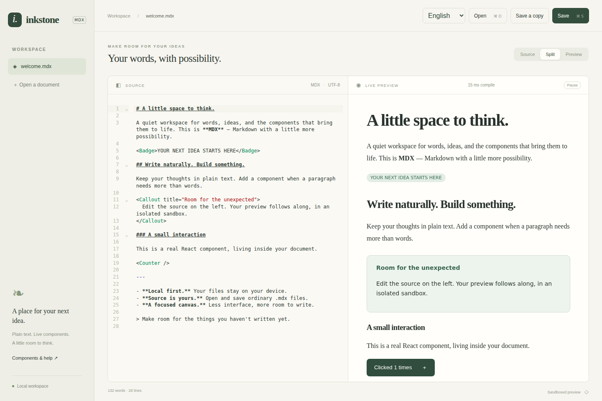
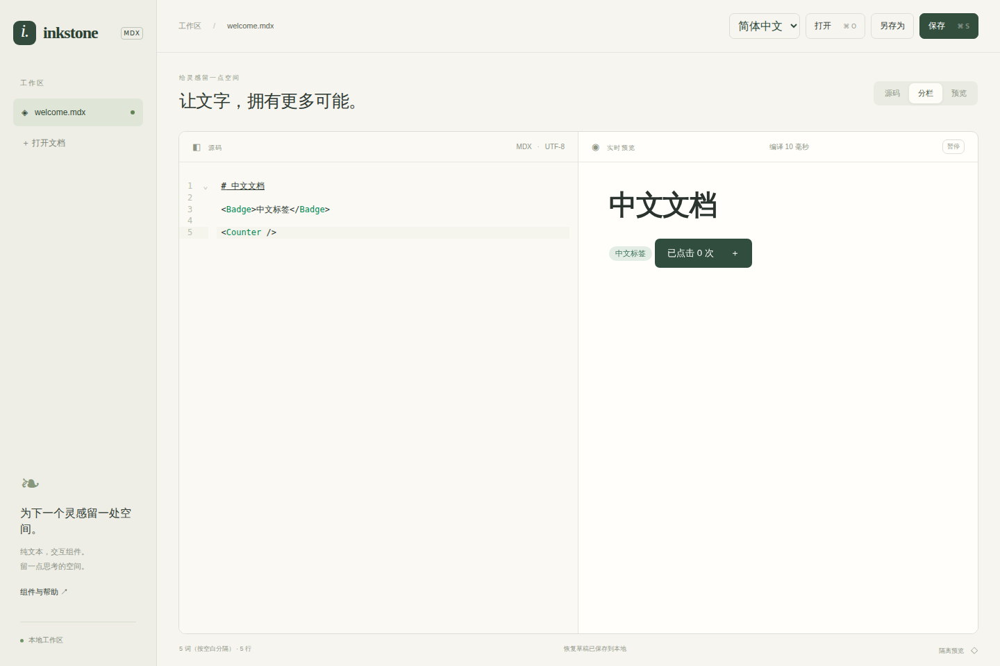
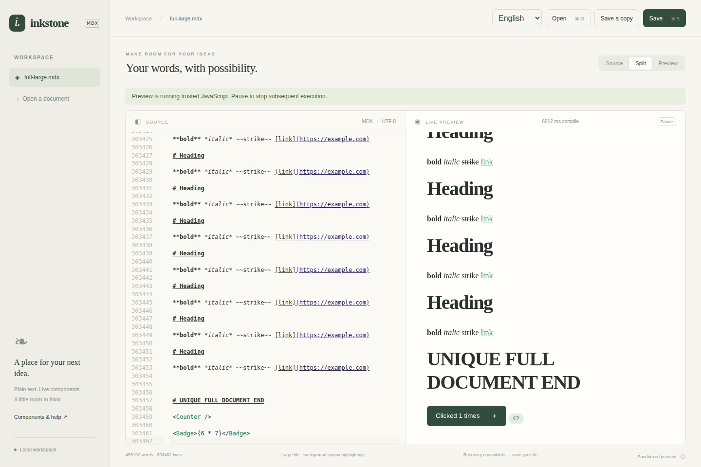

# Inkstone MDX

**让文字，拥有更多可能。**

一个本地优先、源码优先的 MDX 编辑器：在安静的双栏工作区里编写 Markdown、使用 React 组件，并实时查看结果。提供网页版与 Windows / macOS / Linux 桌面版。

[English](README.en.md) · [MIT License](LICENSE) · [桌面版指南](docs/DESKTOP.md) · [测试与限制](docs/EXTENDED-VALIDATION.md)

> **v0.1.0 已发布**：[下载正式版本](https://github.com/kingshuoxu/inkstone-mdx/releases/tag/v0.1.0)，包含完整大文件预览。桌面安装包未签名，macOS 未公证。请只运行可信的 MDX 文档与项目。

## 页面预览

下面是正常开启预览的实际界面：左侧编辑源码，右侧显示文档和可交互的 React 组件。



## 功能与特点

- **写作与组件在一起**：Markdown、GFM 表格/任务列表/删除线、JSX 和 JavaScript 表达式；内置 `Callout`、`Badge`、`Card`、`Counter`，预览中的 React 组件可以真正交互。
- **专注的编辑体验**：源码 / 分栏 / 预览三种布局，行号、查找、撤销/重做、括号补全与 Markdown 风格语法高亮。不是完整的 MDX IDE 或语言服务器。
- **中英文界面**：简体中文 / English 随时切换，记住选择；支持 UTF-8 中文文件名和内容。界面切换不会翻译文档。
- **本地文件工作流**：打开 `.mdx`、`.md`、`.markdown`，保存、另存为、未保存提示和外部修改冲突检测。桌面版使用原生文件操作；网页版的直接写回能力取决于浏览器，不支持时下载副本。
- **桌面项目预览**：显式信任项目后，可导入本地组件与项目中已安装的浏览器兼容 npm 依赖。支持撤销信任；不会自动安装依赖或执行项目构建配置。
- **Rust/WASM 编译核心**：较大 MDX 的解析、语法树转换和 JavaScript 生成走 Rust/WASM；小文档及部分兼容性场景回退 JavaScript。UI、文件操作和 React 渲染并没有重写为 Rust。
- **大文件保留高亮**：超过 100 万个 UTF-16 单元时，自动切换到后台增量解析，只向主线程传回可视区域样式，不再靠整体关闭高亮换取流畅输入。
- **本地优先**：无需账号、后端或付费服务，没有应用遥测或文档上传。草稿保存在本机浏览器/应用配置中；草稿恢复不等于可靠备份。

### 中文页面



### 完整大文件预览

约 5 MiB、303,462 行的真实测试文档，源码高亮与完整预览同时保留。下面滚动到了文档末尾，末尾的 Counter 已成功点击。



以上均为 `cea179e` 生产构建在 Chromium 中的实际截图，不是设计稿。测试文档为合成数据；截图来源与校验值见[截图说明](docs/screenshots/README.md)。

## 实测性能

以下为 `cea179e` 在 GitHub Actions Linux runner、Chromium、生产构建下的完整预览测试，**包含编译与 React 就绪，不是仅解析耗时**。每个样本为一次测试观察值，不是多次运行中位数。

| 测试文档               | UTF-8 字节数 |    行数 | 编译开始至 React 就绪 | 启用预览后至自动化观察到就绪 | DOM 元素数 |
| ---------------------- | -----------: | ------: | --------------------: | ---------------------------: | ---------: |
| 普通长段落             |    5,231,639 |   2,762 |               1.504 s |                      3.384 s |      1,391 |
| 富格式标题、强调与链接 |    5,234,634 | 303,462 |              13.741 s |                     15.768 s |    455,193 |

[对应 Verify CI](https://github.com/kingshuoxu/inkstone-mdx/actions/runs/44262522045)。两组均验证了末尾唯一标题、末尾 Counter 交互，以及编辑后的新标题。Rust 解析器的编辑映射索引减少了长文档中的重复线性扫描；后台高亮避免编辑输入等待整篇高亮计算。

文档结构会显著影响成本：相近字节数不代表相近预览耗时。大 React 树仍需时间和内存，以上不是所有设备的延迟或帧率保证。实现边界见[完整预览说明](docs/LARGE-PREVIEW.md)，早期编译器基准见[历史 Rust 性能报告](docs/RUST-PERFORMANCE.md)。

### 当前边界

- 首次打开、快速滚动或修改后，高亮可能短暂延迟；大文件 Worker 路径暂不提供依赖语法树的折叠与缩进。
- 文件打开上限 **5 MiB**，桌面保存 / IPC 也受此限制；完整预览源码上限同为 **5 MiB**。这些是资源保护阈值，不是 MDX 格式限制，见 [大小限制说明](docs/LIMITS.md)。
- 草稿恢复受本地存储配额影响，超大文档可能无法恢复；请主动保存文件。
- 网页版不支持项目导入。桌面版也不支持 Node 原生模块、服务端包或任意项目插件；支持范围见 [桌面版指南](docs/DESKTOP.md#supported-boundaries)。
- `.md` 文件同样按 MDX 解析，不是纯 Markdown 兼容模式，字面量花括号或尖括号可能需要转义。

## 开始使用

### 下载桌面版

在 [v0.1.0 Release](https://github.com/kingshuoxu/inkstone-mdx/releases/tag/v0.1.0) 的 **Assets** 下载对应平台安装包；同页提供 `SHA256SUMS.txt` 和 `BUILD-MANIFEST.json` 供校验。当前没有自动更新器。

- macOS：Apple Silicon（arm64）/ Intel（x64），DMG / ZIP
- Windows：x64，NSIS 安装程序（EXE）
- Linux：x86_64 / amd64，AppImage / DEB

安装后的应用不需要 Rust 或 Node 开发环境。安装包未签名 / 未公证，不能将打包成功等同于完整安装向导已验证。

### 从源码启动

需要 Node.js **22.12+**（CI 使用 Node 24）、npm、稳定版 Rust 工具链及系统构建工具。获取 main 分支：

```sh
git clone --branch main https://github.com/kingshuoxu/inkstone-mdx.git
cd inkstone-mdx
rustup target add wasm32-unknown-unknown
cargo install wasm-bindgen-cli --version 0.2.105 --locked
npm ci
npm run build:core
npm run dev
```

打开 Vite 打印的本地地址。`npm run build` 生成 `dist/`，用 HTTP 静态服务器提供它；不支持直接双击 `file://` 打开。

```sh
npm run desktop       # 构建并启动 Electron 桌面版
npm run desktop:dist  # 为当前操作系统生成 release/ 下的安装包
```

桌面项目示例：先运行 `npm ci --prefix examples/project --ignore-scripts`，在应用里选择“打开项目”，信任 `examples/project` 后打开其中的 MDX。组件依赖变化后使用“重新构建”刷新。更多说明见 [桌面工作流](docs/DESKTOP.md)。

## 信任与安全

**MDX 是可执行 JavaScript，不只是文本。** 打开文件或恢复草稿后，预览默认暂停，需明确确认信任才执行。预览在不带 `allow-same-origin` 的 sandbox iframe 中运行，桌面预览没有 Node / preload 权限；这不是运行恶意代码的安全服务。无限循环或内存耗尽仍可能卡住或崩溃应用。请仅运行可信文档，并将可信项目根目录限定在必要范围，不要选择包含敏感文件的整个主目录。

原生保存提供尽力而为的冲突检测，不是操作系统级文件锁；草稿是明文存储。详细行为与安全边界见 [使用指南](docs/USAGE.md) 和 [桌面安全说明](docs/DESKTOP.md#trust-and-isolation)。

## 测试与开发

提交 `cea179e` 的验证快照（文档后续更新不改变该测试对象）：

- [Verify CI](https://github.com/kingshuoxu/inkstone-mdx/actions/runs/44262522045)：39 项 JS 测试、项目 Rust 测试、62 项浏览器测试（另有 2 项预期跳过）及 8 项性能对比通过；上游 Markdown 的 178 项测试通过，36 组解析结果哈希与原版一致。
- [Desktop CI](https://github.com/kingshuoxu/inkstone-mdx/actions/runs/44262521948)：Windows、macOS、Linux 源码交互、打包及打包后交互通过。
- 覆盖完整大文件末尾、组件交互、后续编辑、Unicode、引用与脚注、过期结果取消、高亮及接近 5 MiB 文件保存。Linux 有真实 IBus 输入法覆盖；Windows/macOS 真实输入法、长期压力和完整安装向导尚未覆盖。

```sh
npm ci --prefix examples/project --ignore-scripts
npm test
cargo test --manifest-path core/Cargo.toml --locked
npm run build
npm run test:worker
npx playwright install chromium
npm run test:e2e
npm run test:desktop   # Linux 无图形会话时需要 Xvfb
npm run format:check
```

[扩展验证说明](docs/EXTENDED-VALIDATION.md) · [历史验证报告](docs/VALIDATION.md) · [Rust 核心](core/README.md)

## 开源协议

[MIT](LICENSE) © 2026 Inkstone MDX contributors。允许使用、修改和商业分发，需保留版权及许可声明；软件按原样提供，不附带担保。第三方依赖保留各自许可证。

### 检查桌面更新

桌面菜单“帮助 → 检查更新”可从本仓库 GitHub Release 检查正式版本；确认后下载对应平台安装包并校验 SHA-256。应用不会自动安装或退出，也不会后台检查。请保存工作后手动安装。详情见[更新说明](docs/UPDATES.md)。已发布的 v0.1.0 不含此功能，需要先手动安装包含本功能的新版本。
