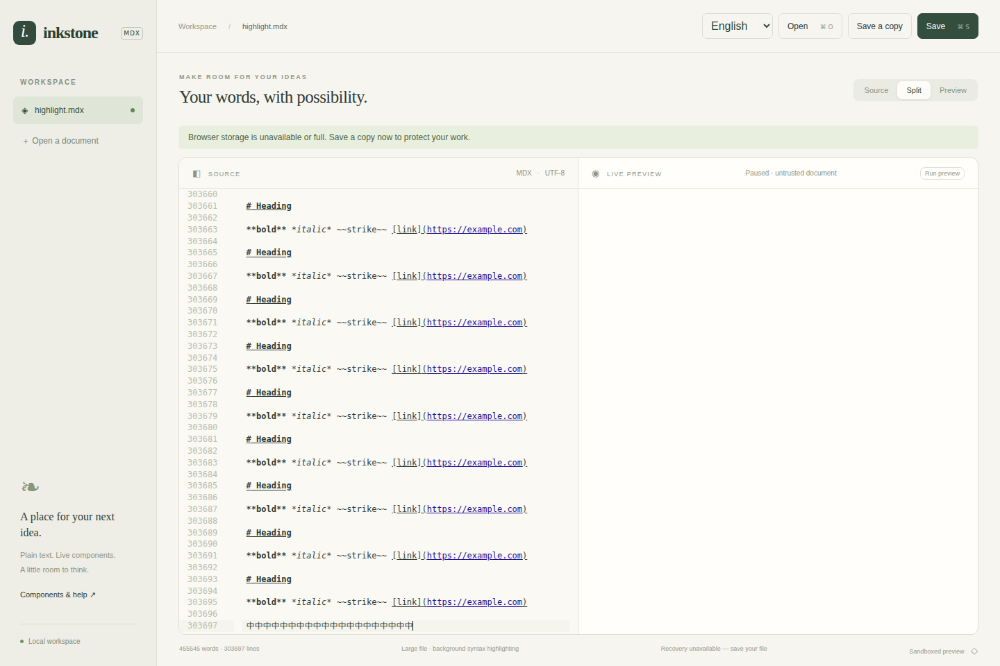

# Inkstone MDX

**让文字，拥有更多可能。**

一个本地优先、源码优先的 MDX 编辑器：在安静的双栏工作区里编写 Markdown、使用 React 组件，并实时查看结果。提供网页版与 Windows / macOS / Linux 桌面版。

[English](README.en.md) · [MIT License](LICENSE) · [桌面版指南](docs/DESKTOP.md) · [测试与限制](docs/EXTENDED-VALIDATION.md)

> **开发预览版**：本页描述 `main` 分支的功能；[PR #3](https://github.com/kingshuoxu/inkstone-mdx/pull/3) 已合并，尚未正式发布。桌面测试包未签名，macOS 未公证。请只运行可信的 MDX 文档与项目。


## 功能与特点

- **写作与组件在一起**：Markdown、GFM 表格/任务列表/删除线、JSX 和 JavaScript 表达式；内置 `Callout`、`Badge`、`Card`、`Counter`，预览中的 React 组件可以真正交互。
- **专注的编辑体验**：源码 / 分栏 / 预览三种布局，行号、查找、撤销/重做、括号补全与 Markdown 风格语法高亮。不是完整的 MDX IDE 或语言服务器。
- **中英文界面**：简体中文 / English 随时切换，记住选择；支持 UTF-8 中文文件名和内容。界面切换不会翻译文档。
- **本地文件工作流**：打开 `.mdx`、`.md`、`.markdown`，保存、另存为、未保存提示和外部修改冲突检测。桌面版使用原生文件操作；网页版的直接写回能力取决于浏览器，不支持时下载副本。
- **桌面项目预览**：显式信任项目后，可导入本地组件与项目中已安装的浏览器兼容 npm 依赖。支持撤销信任；不会自动安装依赖或执行项目构建配置。
- **Rust/WASM 编译核心**：较大 MDX 的解析、语法树转换和 JavaScript 生成走 Rust/WASM；小文档及部分兼容性场景回退 JavaScript。UI、文件操作和 React 渲染并没有重写为 Rust。
- **大文件保留高亮**：超过 100 万个 UTF-16 单元时，自动切换到后台增量解析，只向主线程传回可视区域样式，不再靠整体关闭高亮换取流畅输入。
- **本地优先**：无需账号、后端或付费服务，没有应用遥测或文档上传。草稿保存在本机浏览器/应用配置中；草稿恢复不等于可靠备份。

### 中文页面


### 大文件高亮



以上是 `4d269a4` 生产构建在 Chromium 中的真实运行截图，不是设计稿。大文件截图暂停了预览；顶部提示反映该测试文档超出浏览器草稿存储容量，文件保存与草稿恢复是两回事。截图来源与校验值见 [截图说明](docs/screenshots/README.md)。

## 性能：保留高亮，而不是牺牲高亮

同一 GitHub Actions Linux runner、Chromium、生产构建，约 **5 MiB** 文档，**暂停预览**，每组 20 次自动化输入。测量 `beforeinput` 到下一动画帧；旧版使用主线程高亮，新版使用后台 Worker 高亮。

| 测试文档   | 旧版中位数 / p95 |  新版中位数 / p95 |
| ---------- | ---------------: | ----------------: |
| 普通长段落 | 292.5 / 303.9 ms | **8.4 / 16.2 ms** |
| 富格式文档 |   47.5 / 64.2 ms | **8.3 / 15.9 ms** |

数据来自提交 `4d269a4` 的 [同机对比 CI](https://github.com/kingshuoxu/inkstone-mdx/actions/runs/44084892798)，基线为 `19f4d5b`。这是编辑响应测试，**不是物理键盘延迟、完整实时预览性能或所有设备的帧率保证**。

Rust 编译器的收益是另一项独立测量：在已记录的 Linux / Node 24 编译基准中，约 100 KB 复杂 MDX 的暖编译中位数从 651.8 ms 降到 198.3 ms；约 500 KB 时为 3342.1 → 2994.8 ms。它并非所有情况下都更快，也不会消除 React 渲染或执行文档代码的成本。完整条件、冷启动与内存数据见 [Rust 性能报告](docs/RUST-PERFORMANCE.md)。

### 当前边界

- 首次打开、快速滚动或修改后，高亮可能短暂延迟；大文件 Worker 路径暂不提供依赖语法树的折叠与缩进。
- 文件打开上限 **5 MiB**，桌面保存 / IPC 也受此限制；预览源码上限 **512,000 UTF-8 字节**。这些是资源保护阈值，不是 MDX 格式限制，见 [大小限制说明](docs/LIMITS.md)。
- 草稿恢复受本地存储配额影响，超大文档可能无法恢复；请主动保存文件。
- 网页版不支持项目导入。桌面版也不支持 Node 原生模块、服务端包或任意项目插件；支持范围见 [桌面版指南](docs/DESKTOP.md#supported-boundaries)。
- `.md` 文件同样按 MDX 解析，不是纯 Markdown 兼容模式，字面量花括号或尖括号可能需要转义。

## 开始使用

### 下载桌面测试包

在 [Desktop 工作流](https://github.com/kingshuoxu/inkstone-mdx/actions/workflows/desktop.yml) 中选择成功运行，在 **Artifacts** 下载对应平台产物。作为已验证快照，也可以查看 [4d269a4 的三平台构建](https://github.com/kingshuoxu/inkstone-mdx/actions/runs/44084892678)。下载通常需要登录 GitHub，产物会过期；当前没有正式 Release 或自动更新器。

- macOS：DMG / ZIP
- Windows：NSIS 安装程序
- Linux：AppImage / DEB

安装后的应用不需要 Rust 或 Node 开发环境。安装包未签名 / 未公证，不能将打包成功等同于完整安装向导已验证。

### 从源码启动

需要 Node.js **22.12+**（CI 使用 Node 24）、npm、稳定版 Rust 工具链及系统构建工具。从默认主分支获取源码：

```sh
git clone https://github.com/kingshuoxu/inkstone-mdx.git
cd inkstone-mdx
rustup target add wasm32-unknown-unknown
cargo install wasm-bindgen-cli --version 0.2.105 --locked
npm ci
npm run build:core
npm run dev
```

打开 Vite 打印的本地地址。`npm run build` 生成 `dist/`，用 HTTP 静态服务器提供它；不支持直接双击 `file://` 打开。

```sh
npm run desktop       # 构建并启动 Electron 桌面版
npm run desktop:dist  # 为当前操作系统生成 release/ 下的安装包
```

桌面项目示例：先运行 `npm ci --prefix examples/project --ignore-scripts`，在应用里选择“打开项目”，信任 `examples/project` 后打开其中的 MDX。组件依赖变化后使用“重新构建”刷新。更多说明见 [桌面工作流](docs/DESKTOP.md)。

## 信任与安全

**MDX 是可执行 JavaScript，不只是文本。** 打开文件或恢复草稿后，预览默认暂停，需明确确认信任才执行。预览在不带 `allow-same-origin` 的 sandbox iframe 中运行，桌面预览没有 Node / preload 权限；这不是运行恶意代码的安全服务。无限循环或内存耗尽仍可能卡住或崩溃应用。请仅运行可信文档，并将可信项目根目录限定在必要范围，不要选择包含敏感文件的整个主目录。

原生保存提供尽力而为的冲突检测，不是操作系统级文件锁；草稿是明文存储。详细行为与安全边界见 [使用指南](docs/USAGE.md) 和 [桌面安全说明](docs/DESKTOP.md#trust-and-isolation)。

## 测试与开发

提交 `4d269a4` 的验证快照：

- [Verify CI](https://github.com/kingshuoxu/inkstone-mdx/actions/runs/44084892798)：38 项 JS、2 项 Rust、46 项浏览器测试和 8 项新旧版本对比通过。
- [Desktop CI](https://github.com/kingshuoxu/inkstone-mdx/actions/runs/44084892678)：Windows、macOS、Linux 源码交互、打包及打包后交互通过。
- 覆盖中文内容、跨行语法、快速修改、滚动、撤销、Worker 故障恢复、接近 5 MiB 文件的编辑与保存。Linux 有真实 IBus 输入法覆盖；Windows/macOS 真实输入法、长期压力和完整安装向导尚未覆盖。
- 中间一次 Windows 自动化保存校验得到未修改的原文，后续多次通过，但该次失败根因尚未证实；不宣称所有偶发问题均已解决。

```sh
npm ci --prefix examples/project --ignore-scripts
npm test
cargo test --manifest-path core/Cargo.toml --locked
npm run build
npm run test:worker
npx playwright install chromium
npm run test:e2e
npm run test:desktop   # Linux 无图形会话时需要 Xvfb
npm run format:check
```

[扩展验证说明](docs/EXTENDED-VALIDATION.md) · [历史验证报告](docs/VALIDATION.md) · [Rust 核心](core/README.md)

## 开源协议

[MIT](LICENSE) © 2026 Inkstone MDX contributors。允许使用、修改和商业分发，需保留版权及许可声明；软件按原样提供，不附带担保。第三方依赖保留各自许可证。
